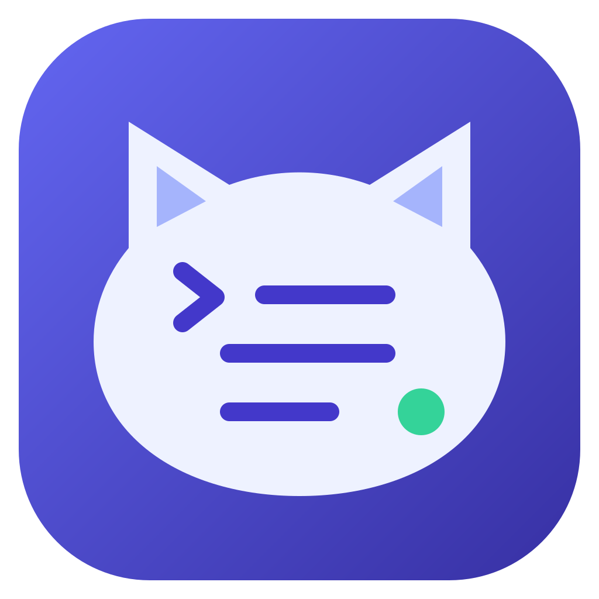

# Simply Logs



A local-first Electron app for Windows, Linux, and macOS. Follow deployment activity, inspect Vercel build logs and Vercel/Netlify runtime logs, and check public application health with a small cat companion. The operating system provides real window controls; there is no window-style preview switch.

On Windows and Linux, the File/Edit/View menu bar is hidden, including when pressing Alt; its keyboard shortcuts remain available. macOS keeps its native menus.

## Run locally

Use Node.js 26.x and npm. The included `.nvmrc` selects Node 26 for nvm users. No environment file, hosted backend, or provider token is required for URL-only monitoring. Installed apps use Electron's bundled runtime; end users do not need Node.js.

```sh
npm ci
npm run dev
```

Create a project, then add an application:

- **Public URL health checks:** enter a real public HTTPS URL. Checks run every 15 seconds, one at a time per application.
- **Provider account:** enter a Vercel or Netlify personal access token, or choose a saved token from another application using the same provider, then discover your applications or supply a project/site ID. Deployment status syncs every 30 seconds. Both providers load the past hour of runtime history when monitoring connects and stream new runtime logs. Vercel also retrieves up to 1,000 recent build events per poll. Vercel teams are supported; account discovery follows pagination.

Netlify build logs remain in its dashboard; this app retrieves Netlify deployment status and Function/Edge Function runtime logs, not build output. Log access depends on token permissions, plan access, retention and provider limits. Failed requests are shown explicitly; they never become successful deployments. Health-check latency and failure percentages describe the checks themselves, not your application's request throughput.

For **Vercel runtime logs**, edit the application and select **Provider account + health**, then connect a token and project (plus Team ID when needed). On connection, the app fetches up to 1,000 runtime requests from the past hour for that project's selected environment, including previous deployments. Historical console output is grouped per request; individual messages, levels and truncation flags are retained in the log details/export. History merges chronologically with saved and live logs, using provider IDs to deduplicate. Loading old output does not trigger alerts or inflate live throughput. No new traffic is needed to see retained logs.

The live stream follows the project's active production deployment, including promotions/rollbacks, or its latest ready preview deployment. Selection is refreshed every 30 seconds. Local development logs are unsupported. Use the `runtime`, `serverless`, or `edge` source filters to separate runtime status, function logs, and edge logs from build/probe entries. Request metadata, provider severity, timestamps and truncation flags are retained in the viewer/export.

Runtime logs use the historical query endpoint used by [Vercel's CLI](https://github.com/vercel/vercel/blob/main/packages/cli/src/util/logs-v2.ts) alongside Vercel's [deployment runtime-log stream](https://vercel.com/docs/rest-api/logs/get-logs-for-a-deployment), not a Log Drain, and need no hosted receiver or installed Vercel CLI. The query endpoint is separate from the documented REST stream and may change. History and live logging connect independently; permission, retention, query-limit and network failures are shown explicitly. Failed history queries retry on the next 30-second refresh until a query succeeds. A partial query produces a warning. Ended/failed streams also warn and retry. This is **not guaranteed complete ingestion**: reconnects, deployment switches and provider limits can leave gaps. Hobby retains one hour of runtime history; older provider-expired logs cannot be backfilled. Pause, project changes, application edits, window reloads and window closure cancel old streams/history requests and ignore late events. URL-only health checks do not retrieve application logs; use the deployed public URL, not a Vercel dashboard/login URL.

For **Netlify runtime logs**, select **Netlify** and **Provider account + health**, then connect a token and Site ID. Production follows the site's published deployment, including rollbacks; preview follows the latest ready deploy preview or branch deploy. Every 30 seconds the app rechecks this selection. Local development logs are unsupported. History covers the past hour of the deployment selected on connection, capped at 1,000 log lines across sources; it does not backfill earlier deployments. Function streams use the function identifiers listed in the selected deployment; Edge Function streams are explicitly deployment-scoped. Function names and available request IDs/paths are retained in log details and exports. Use `serverless` for Functions, `edge` for Edge Functions, and `runtime` for connection warnings.

Netlify logging uses the analytics/history and authenticated WebSocket services used by [Netlify's CLI](https://github.com/netlify/cli/tree/main/src/commands/logs), without installing that CLI or hosting a Log Drain receiver. These endpoints may change. Up to 10 Functions per application are monitored, chosen alphabetically by name; additional Functions produce a visible warning rather than silently disappearing. Edge Functions use a separate stream. History requests follow pagination and merge chronologically with saved/live output. Since Netlify does not provide a stable line ID in both transports, deduplication uses source, function name, timestamp, level and message; identical lines within one millisecond may collapse, and timestamp-less live entries use receipt time. Individual source failures retain other available logs, warn explicitly and retry after 30 seconds. Pause, edits, project changes, reloads and closing the window cancel pending history, retry timers and sockets. Historical output never triggers fresh alerts or inflates live throughput.

Projects and environment selection scope the log viewer, counters, exports, and manual actions. Background monitoring watches all applications in the selected project. The newest 1,000 entries across projects, including runtime logs, are saved locally and restored after switching projects or restarting. Restoring history does not replay alerts. Clearing logs removes the selected project's saved history and ignores older in-flight backfill; a subsequent app restart can fetch recent provider history again. Deleting an application or project removes its saved logs. Storage failures are reported in the app; export JSON using the toolbar to keep a longer-term record.

To update a project's name, description, color or tags, use **Edit current project** in the project selector, or the pencil button beside **Project Context** in the sidebar. Editing preserves its applications, credentials, logs and current monitoring/filter selections. Descriptions and tags can be cleared; changes are saved locally.

Log rows show an HTTP method badge when the provider supplies one, so an `OPTIONS` preflight is distinguishable from the actual request. Methods are searchable (case-insensitive) and included in copied log text and JSON exports; logs without a method are not assigned one.

**Pause** stops polling and ignores in-flight observations. Resume collects fresh state. Space toggles monitoring unless focus is in a control or dialog. Alerts are deduplicated by application and monitor type; recovery requires a fresh healthy observation after the configured recovery window, not silence. The footer sound switch and alert settings share one setting, including cat sounds.

Monitoring and desktop alerts run only while the app is open. Closing the last window quits on Windows/Linux; macOS follows its native application lifecycle. Monitoring is suspended when no window exists.

## Credentials and privacy

Tokens stay in the Electron main process. When the OS keychain is available, Electron `safeStorage` encrypts them before they are written to the application's private data directory. Linux `basic_text` storage is explicitly rejected. If no secure keychain is available, tokens remain **session-only**, the app displays a warning, and you must reconnect after restarting. On Linux, enable a Secret Service/keyring or supported KWallet backend for persistent credentials.

Renderer storage contains project configuration and credential identifiers, never new plaintext tokens. Legacy plaintext tokens are migrated into the credential vault; old sample applications are removed. Storage errors are reported rather than replaced with sample data. OS notification permissions are managed in system settings.

In account onboarding or editing, **Access token** offers saved tokens from applications using the same provider, including applications in other projects. Each token appears once, labeled with an application that uses it. Discovery resolves the saved credential in the main process without returning its value to the renderer. Team IDs and application settings are separate from the shared token. Choose **Enter a new token** to connect a different account or replace a token for just that application. Changing or deleting an application/project retains tokens still used elsewhere; the last reference's removal deletes its token from the vault. Session-only tokens can also be reused until the app exits, but must be re-entered after restarting.

Received log history is also kept in local renderer storage, without encryption, and may contain sensitive application output. Clear logs to remove the selected project's saved entries.

The renderer is sandboxed, has no Node.js access, cannot make production network requests, and uses a narrow, sender-validated IPC bridge. There is no HTTP proxy or listening production server. Outbound requests require public HTTPS destinations, reject private/reserved IPs and custom ports, pin validated DNS addresses, revalidate redirects, limit response size, and time out. Runtime streams remain open while monitoring is active, with a 2 MB limit per JSON line instead of a total response-size limit or an idle timeout, including while waiting for their first response headers. Netlify WebSockets likewise require public WSS destinations, pin DNS, refuse redirects and cap each message at 2 MB; authentication is sent only after the TLS/WebSocket handshake. DNS resolution and TLS connection establishment still have eight-second deadlines. Private/local development services and self-signed HTTPS are deliberately unsupported.

Application data normally lives under `%APPDATA%/Simply Logs` (Windows), `~/Library/Application Support/Simply Logs` (macOS), or `~/.config/Simply Logs` (Linux). Do not delete these directories to update the app.

## Build and install

```sh
npm run check        # strict TypeScript checks, regression tests, production build
npm run start        # open the built desktop app
npm run pack         # create an unpacked application for the current OS
npm run dist         # create installers for the current OS under release/
```

| Platform | Installable artifacts |
| --- | --- |
| Windows | NSIS `.exe` installer |
| Linux | `.AppImage` and `.deb` |
| macOS | `.dmg` and `.zip`, Intel and Apple Silicon builds |

Build native installers on their corresponding operating systems. To request both macOS architectures, run `npm run dist -- --mac --arm64 --x64` on macOS. The included GitHub Actions workflow checks all three platforms, runs desktop smoke tests, and uploads installer artifacts. It does not publish releases or upload application data.

Local/CI artifacts are **unsigned by default**. Configure Electron Builder code signing and Apple notarization with your own developer certificates before public distribution; unsigned builds may be blocked or warned about by Windows/macOS. Signing credentials must only be supplied as protected CI secrets, never committed.

Linux requires the standard Electron/Chromium desktop libraries, including NSS, GTK, and ALSA. AppImage may additionally require FUSE; use its `--appimage-extract-and-run` option when FUSE is unavailable, or install the `.deb` instead.

## Tests

```sh
npm test
npm run build
npm run test:desktop
# Headless Linux:
xvfb-run -a npm run test:desktop
```

Desktop tests use an isolated temporary profile and mocked provider responses. They cover onboarding, project/environment isolation, sandbox/CSP boundaries, credential handling, pause/resume, and shared sound settings. They do not require a real provider account. In restricted CI environments where Chromium cannot initialize its OS sandbox, set `SIMPLY_LOGS_NO_SANDBOX=1` **for the smoke test only**; production app settings retain sandboxing.

`npm run dev` bundles the main process and preload, then runs Vite on loopback and launches Electron. Renderer changes reload automatically. Restart the command after changing main-process or preload code. Opening Vite in a browser is UI preview only.
